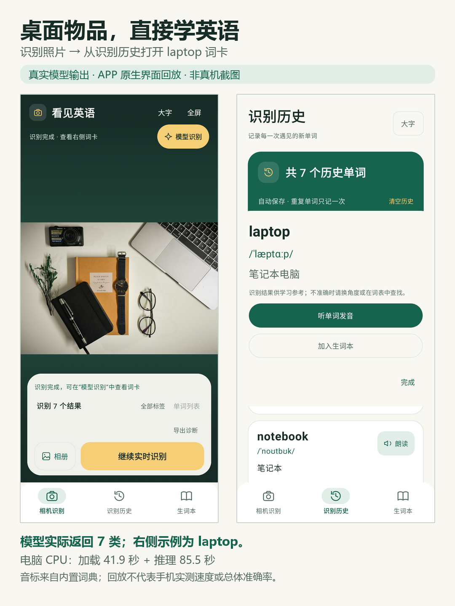
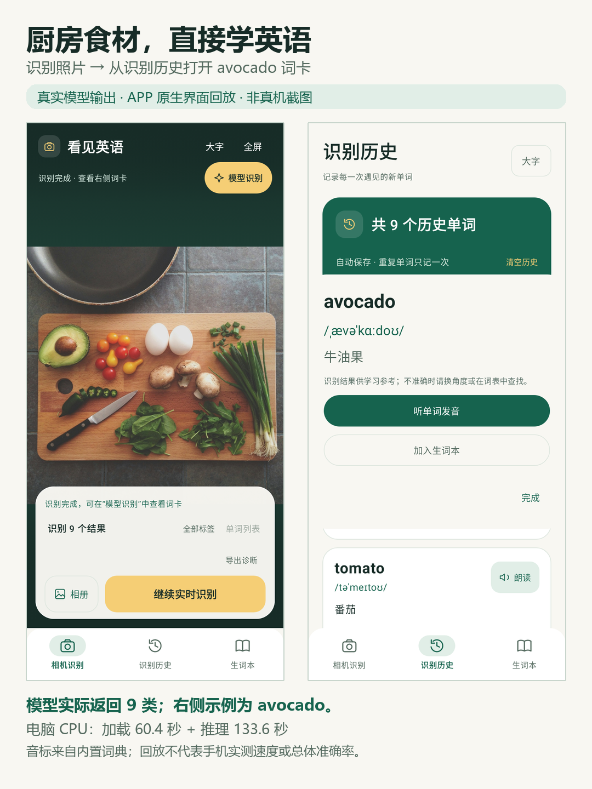
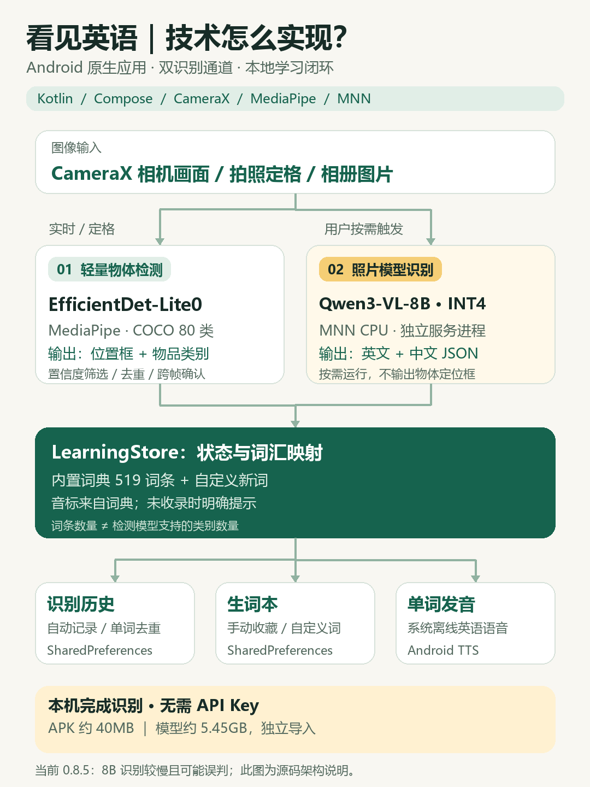

# 看见英语 · See English

把身边的物品变成英语学习素材。一款纯个人兴趣开发、供参考和继续改造的 Android 离线相机 APP，当前版本 **0.8.5**。

## 能做什么

- 相机实时识别与拍照定格，常见物品旁显示英文、现有美式音标与中文；支持相册导入、大字和全屏。
- 拍照后打开「模型识别」，使用手机本地的 Qwen3-VL-8B INT4 模型理解更多物品，结果以词卡展示。
- 听单词发音；手动加入生词本。词库没有的新词也可以收藏，缺少音标时明确标注。
- 自动保存识别历史，同一个单词只记一次；历史与生词本独立，清空历史保留收藏。

实时检测与模型识别是两条不同管线：实时检测仅支持 COCO 80 类；内置 519 条学习词汇不等于能稳定识别 519 类。8B 模型的结果不提供可靠物体框，因此不会把生成的词卡伪装成定位结果。

## 下载与安装

**完整离线包：夸克网盘链接待上传后补充。** 提取码（如有）将一并放在这里。

下载整个 `看见英语-0.8.5-完整离线包` 文件夹，里面已经包含 APK 和完整模型，不需要下载脚本或分卷合并。

1. 安装文件夹里的 `see-english-0.8.5-arm64-debug.apk`。
2. 打开 APP：「模型识别 → 识别设置 → 导入离线识别文件」。
3. 选择下载文件夹里的 `model` 文件夹，等待导入和校验完成，即可拍照识别。

已有正确模型的用户，只需覆盖安装 [最新 APK](artifacts/see-english-0.8.5-arm64-debug.apk)（约 40MB），不用重复导入模型。[详细安装说明](docs/offline-install.txt)。

模型约 5.45GB，包含在完整文件夹中；首次导入会同时保留下载文件与 APP 内副本，建议手机预留 15GB 以上可用存储。无需 API Key、Python 或 Actions。

需要 Android 8.0+、ARM64 手机。8B 模型对内存、存储和算力要求高，低内存手机可能无法完成推理；朗读需要系统已经安装离线英语语音。构建产物是 **debug 测试包**，适合个人体验与开发参考，尚未作为应用商店正式产品发布。其他人自行构建的签名与这里提供的 APK 不同，不能保证直接覆盖安装。

## APP 识词效果

| 桌面物品 → laptop 词卡 | 厨房食材 → avocado 词卡 |
| --- | --- |
|  |  |

两张照片使用实际 8B 模型离线推理，分别返回 7 类与 9 类物品；英文、音标、中文和按钮由当前 APP 的原生界面代码渲染。**这是电脑推理结果的 APP 界面回放，不是手机摄像头现场截图**，图内已标注，不作为手机速度或总体准确率证据。音标来自内置词典，不补画模型没返回的定位框。

[查看原图、原始输出与生成方式](docs/screenshots/README.md)。照片来自 Unsplash，出处和许可见 [素材说明](docs/media/README.md)；更多结果与遗漏说明见 [示例记录](docs/demo.md)。

## 技术架构



相机输入分别进入轻量检测和按需照片模型，经统一词汇映射后用于历史、生词本与离线发音。[技术说明与可编辑 SVG](docs/architecture.md)。

## 当前不足

识别仍会漏检、误判，遮挡、小物体、包装细节和相似外观尤其困难。手机上的 8B 识别较慢，已有体验反馈每张超过 30 秒；耗时因手机与画面而异，没有统一性能承诺。模型文件明显大于 APP，新词音标与翻译的完整性也需要继续改善。

计划优先优化模型加载与推理速度、内存占用、小物体与细分类识别、结果复核，以及离线词典和音标补全。后续可评估更轻的视觉模型；当前无需训练即可使用。

## 本地开发

使用 JDK 17、Android SDK 36 / Build Tools 36.1.0。首次构建需联网下载 Gradle 和依赖，APP 运行与识别不需要网络。

```powershell
# 设置自己的 JDK 与 Android SDK，或用 Android Studio 生成 local.properties
$env:JAVA_HOME = '你的 JDK 17 路径'
$env:ANDROID_HOME = '你的 Android SDK 路径'
./build.cmd
```

macOS/Linux：在 `local.properties` 设置自己的 `sdk.dir` 后运行：

```sh
./gradlew :app:assembleDebug :app:testDebugUnitTest :app:lintDebug -PtargetAbi=arm64-v8a
```

Windows 的 `scripts/build.ps1` 会生成最新 APK 与 SHA-256，旧包不会进入版本管理。USB 安装使用 `install-phone.cmd`。大模型文件不进入 Git 历史；普通用户从上方网盘下载完整文件夹。开发者也可自行运行 `python scripts/download-vlm.py` 下载固定版本。此前的 Actions 打包工作流已停用。

技术栈：Kotlin / Jetpack Compose / CameraX / MediaPipe EfficientDet-Lite0 / MNN。核心状态在 `LearningStore.kt`，相机入口在 `CameraPage.kt`，模型独立进程在 `OfflineVisionService.kt`，模型哈希清单在 `app/src/main/assets/vlm-model.json`。

## 隐私、验证与许可

APP 无 INTERNET 权限，不接云 API，不要求账号或 API Key。照片由本机处理；主动导出的诊断包含照片和设备信息，请自行核对后分享。详见 [隐私说明](PRIVACY.md)。

[本地验证记录](artifacts/verification-0.8.5.json) 包括 33 项本地测试及 Lint；UI 测试使用人工构造数据，不代表模型识别率。公开版本没有覆盖多款手机的性能验证。

本项目原创代码采用 [Apache-2.0](LICENSE)，第三方代码、运行库、模型和照片遵循各自许可，详见 [第三方说明](THIRD_PARTY.md)。欢迎参考、试用和提问题；这是个人兴趣项目。
