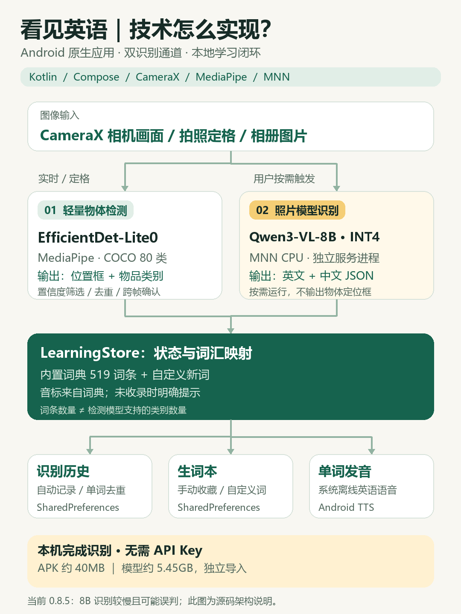

# 看见英语 0.8.5 技术架构

[可编辑 SVG](diagrams/see-english-architecture.svg)。本图按当前源码整理，未添加云服务、NPU 加速、SQLite 或模型训练等尚未实现的组件。

- **输入与 UI**：CameraX 提供相机预览和拍照，相册图片经系统文件选择器导入；界面使用 Kotlin / Jetpack Compose。
- **轻量检测**：`DetectionEngine.kt` 通过 MediaPipe 执行 EfficientDet-Lite0，支持 COCO 80 类，输出位置框与类别。结果经筛选、去重和实时确认后呈现；不是开放词汇检测器。
- **模型识别**：拍照后按需调用 `OfflineVisionClient.kt`，长边缩放到不超过 896px，连接独立 `:offline_vision` Service。`OfflineVisionService.kt` 使用 MNN CPU / 4 线程执行 Qwen3-VL-8B INT4，解析英中 JSON 词条；此通道没有物体定位框。
- **词汇映射与本地学习**：`LearningStore.kt` 管理状态、结果映射、自定义词汇和历史去重。音标来自内置词典；未收录时明确提示。519 条学习词汇不意味着检测支持 519 类。
- **存储与发音**：生词本、自定义词汇、记忆标记和历史通过 SharedPreferences 持久化。单词发音使用系统已有的离线英语 TTS 语音。约 5.45GB 模型独立导入，不在约 40MB 的 APK 中。

APP 无 INTERNET 权限，不接云 API。初次下载 APP / 模型以及首次构建依赖需要网络，与安装完成后的离线识别是不同阶段。该图不代表识别率、推理速度或多机型验证结果。

图片使用仓库统一的森林绿、暖白与浅金色，适合 GitHub 文档或项目分享。重绘命令：`python scripts/render-architecture.py`，需要 Pillow 和中文字体；非 Windows 环境可通过 `--font` / `--bold-font` 指定字体。
