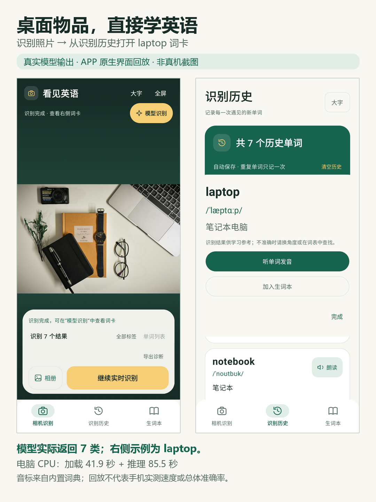
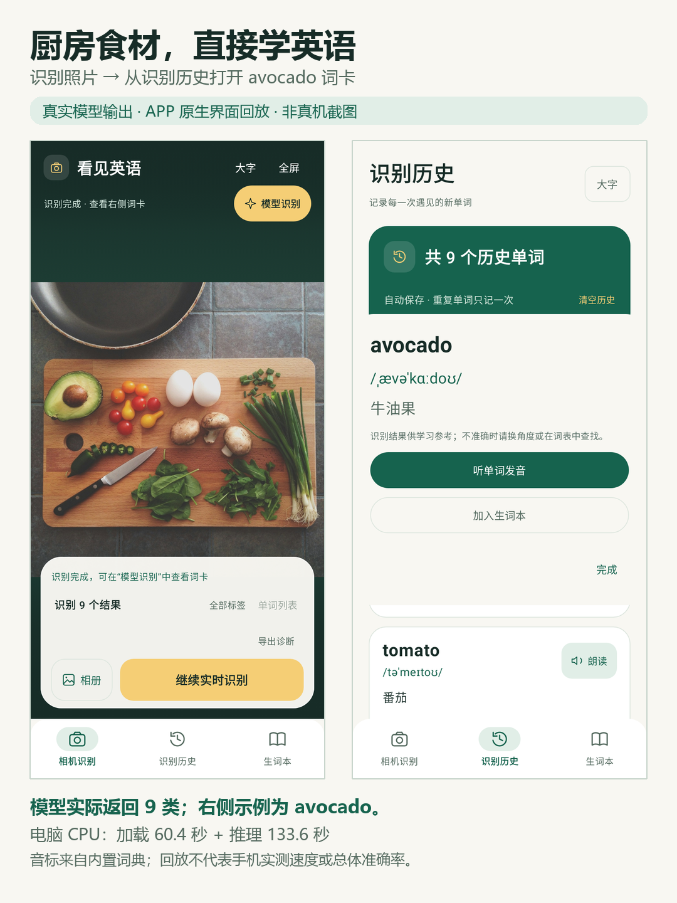

# APP 识词效果示例

| 桌面物品 → laptop 词卡 | 厨房食材 → avocado 词卡 |
| --- | --- |
|  |  |

两张图中的照片经过实际 Qwen3-VL-8B INT4 / MNN 电脑离线推理；返回结果分别为 7 类和 9 类。右侧英文、音标、中文、发音和收藏按钮由当前 APP 的原生 Compose 代码渲染。

**这些是电脑推理结果的 APP 界面回放，不是手机摄像头现场截图。** 当前没有连接安卓设备，未执行 Android 原生模型推理；图中均有相同标注。原始输出没有定位框，图片也没有补画定位框。音标来自内置词典，不由视觉模型生成；回放不会补入模型没返回的物品。

原始记录：[桌面](../media/desk-result.json)、[厨房](../media/kitchen-result.json)。素材授权见 [图片说明](../media/README.md)。图像、输入和记录哈希见 [provenance.json](provenance.json)。加载与推理时间分别保留，不能当作手机速度或总体准确率。

## 重新生成

在 Windows / JDK 17 / 已配置 Android SDK 的开发环境中：

```powershell
$env:SEE_ENGLISH_RENDER_DOCS = '1'
./gradlew.bat :app:testDebugUnitTest --tests com.codex.englishcamera.InterfaceTest -PtargetAbi=arm64-v8a --rerun-tasks
Remove-Item Env:SEE_ENGLISH_RENDER_DOCS
python scripts/render-doc-examples.py
```

排版脚本需要 Pillow；默认使用 Windows 微软雅黑，其他环境可通过 `--font` / `--bold-font` 指定中文字体。`InterfaceTest` 的文档生成分支仅在显式设置上述环境变量时运行，利用保存的真实结果经过 `LearningStore.offlineInference` 回放到正常结果处理流程。它不修改、也不进入发布 APK。
